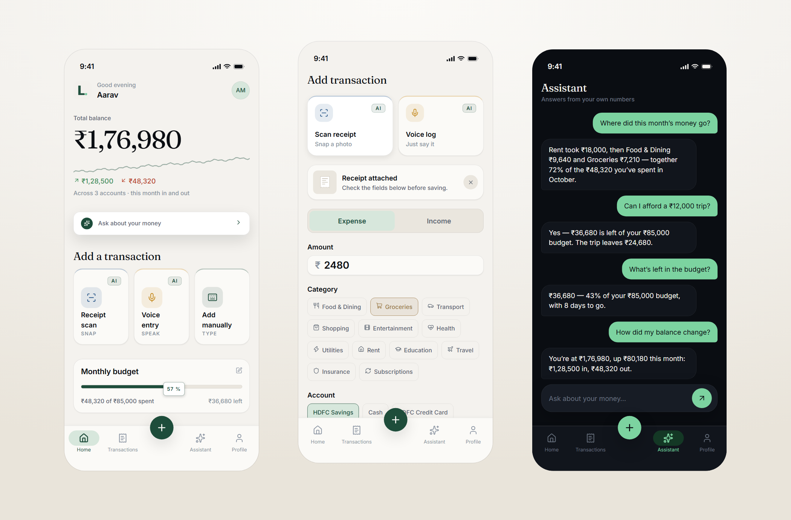
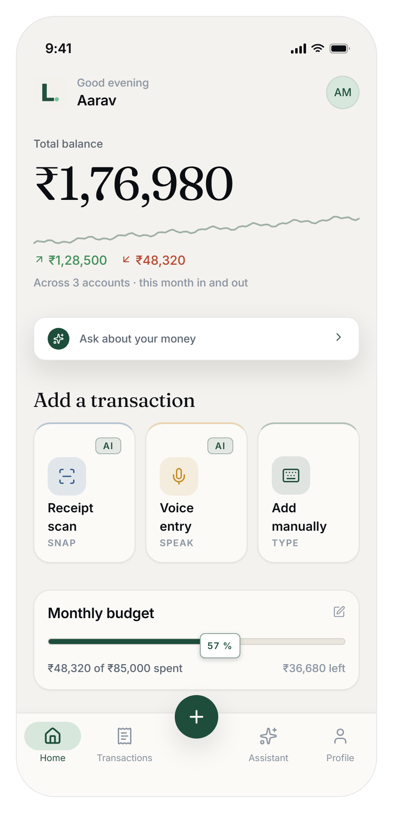
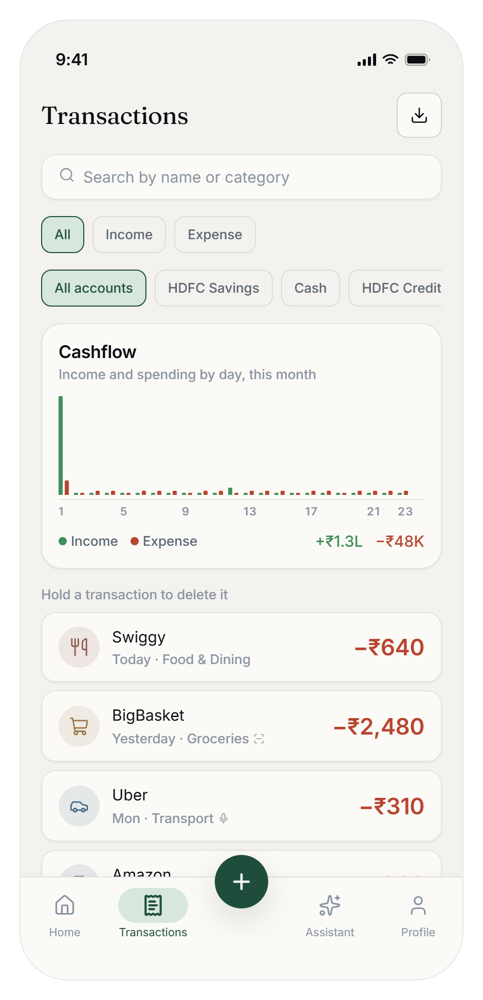
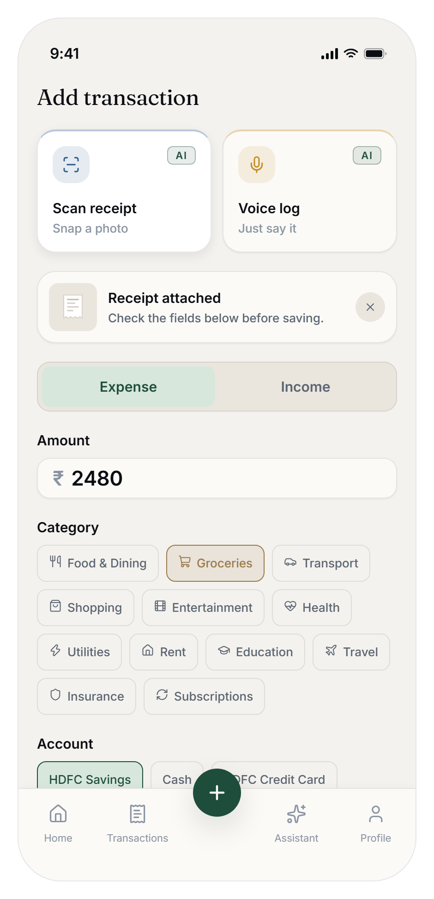
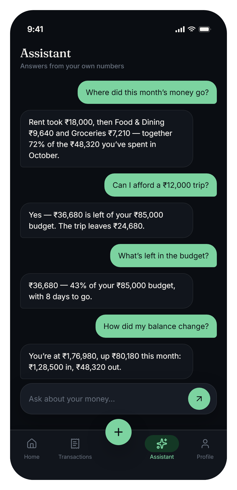
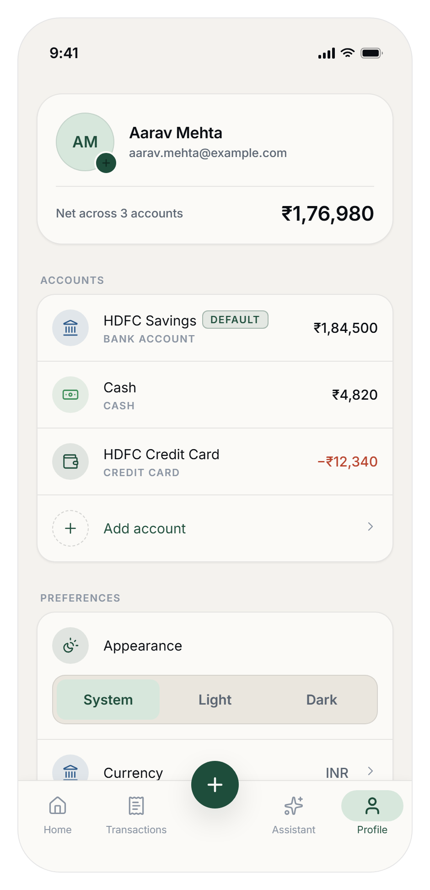
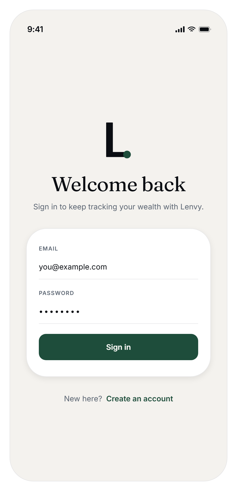
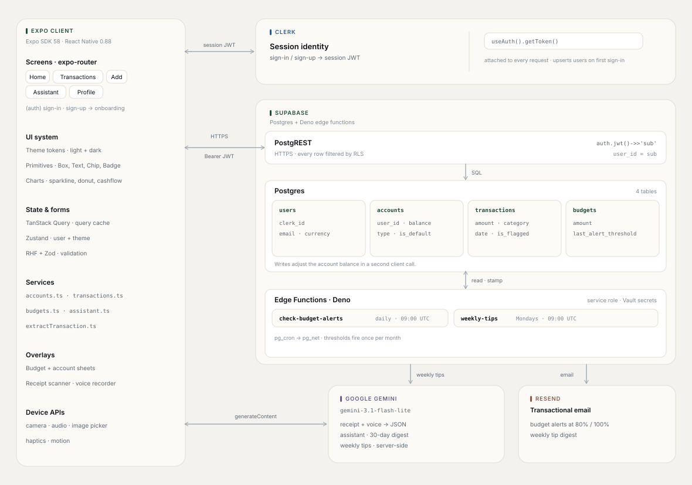

<div align="center">

<picture>
  <source media="(prefers-color-scheme: dark)" srcset="docs/brand/lockup-dark.svg">
  
</picture>

<br />

A personal wealth tracker that keeps one honest picture of your money — every
account, every transaction, every balance. Logging money takes seconds, and every
figure on screen traces back to a transaction.

[Get started](#get-started) · [Architecture](#architecture) · [Screens](#screens) · [Tech stack](#tech-stack)

<br />


</div>

<div align="center">
  
</div>

## Why Lenvy

Budgeting apps usually ask for more typing than the spending was worth. Lenvy
takes the opposite position: logging money should take a second, and the number
on the home screen should still be one you can audit back to a transaction.

It is built for the honest shape of a real life — cash in a wallet, a salary
account, a credit card mid-cycle, savings you leave alone — and shows the lot as
one balance sheet rather than a slice of it.

## What it does

- **The whole balance sheet.** Cash, bank, credit card and savings accounts, each
  with a running balance, and one live net total across them on Home and Profile.
- **Three ways in.** Add manually, scan a receipt, or speak a sentence. Receipt
  and voice drafts are filled by Gemini and always land in an editable form
  before anything is written.
- **A real ledger.** 15 expense and 6 income categories, transaction search, type
  and account filters, and swipe-to-delete with a confirmation.
- **An assistant that stays grounded.** Ask "how am I doing this month?" and it
  answers from a 30-day digest of your own transactions — with instructions not
  to invent a figure when the data is not there.
- **Budget pressure, not gamification.** One monthly figure, a progress rail on
  the dashboard, and email alerts at 80% and 100% spent.
- **Your data leaves with you.** CSV export of the current ledger through the
  system share sheet.
- **Made to live in.** Light, dark or system appearance, 38 currencies with
  INR-first onboarding, and tabular figures so amounts line up in a column.

## Screens

<table>
  <tr>
    <td width="33%" align="center" valign="top">
      
      <br />
      <sub><b>Home</b> — net worth, sparkline, category mix, budget rail.</sub>
    </td>
    <td width="33%" align="center" valign="top">
      
      <br />
      <sub><b>Transactions</b> — cashflow, search, filters, CSV export.</sub>
    </td>
    <td width="33%" align="center" valign="top">
      
      <br />
      <sub><b>Add</b> — one form, three ways to capture.</sub>
    </td>
  </tr>
  <tr>
    <td width="33%" align="center" valign="top">
      
      <br />
      <sub><b>Assistant</b> — answers from your last 30 days.</sub>
    </td>
    <td width="33%" align="center" valign="top">
      
      <br />
      <sub><b>Profile</b> — accounts, currency, appearance.</sub>
    </td>
    <td width="33%" align="center" valign="top">
      
      <br />
      <sub><b>Sign in</b> — Clerk email and password.</sub>
    </td>
  </tr>
</table>

## Architecture

<div align="center">
  
</div>

Four moving parts, and one rule about each:

| Layer | What lives there | The rule |
| --- | --- | --- |
| **Expo client** | Screens, primitives, charts, overlays, services, device APIs | Screens read through query hooks; writes go through services, apart from onboarding and the currency preference |
| **Clerk** | Session identity | Clerk owns the session; the app only forwards its JWT |
| **Supabase** | PostgREST, Postgres, Deno edge functions | Every row is scoped to the Clerk subject — `user_id` in `accounts`, `transactions` and `budgets`, `clerk_id` in `users` — in the service layer, and by RLS once the policies are in place |
| **External** | Gemini, Resend | AI drafts are reviewed before they commit; email is the only scheduled outbound channel |

### The paths worth knowing

1. **Read.** `useTransactionsQuery` calls `transactions.ts`, which runs a
   PostgREST `select` scoped to the user and filtered by type and account.
   Results land in the TanStack Query cache keyed in `lib/query/keys.ts`.
2. **Write.** Creating a transaction inserts the row, then reads and updates
   `accounts.balance` in a second call, then invalidates `["transactions"]` and
   `["accounts"]`. One invalidation updates the dashboard, the ledger and the
   profile net.
3. **Capture.** A receipt photo or a voice note is base64-encoded and sent to
   `gemini-3.1-flash-lite` with a response schema pinned to the category keys.
   The returned draft populates the Add form; nothing reaches Postgres until the
   user taps save. If the model cannot read a field it returns `null` rather than
   a guess.
4. **Schedule.** `scripts/cron_jobs.sql` wires pg_cron to pg_net to the two edge
   functions, reading the project URL and service-role key from Vault.
   `check-budget-alerts` runs daily at 09:00 UTC and stamps
   `budgets.last_alert_sent` so each threshold fires once per calendar month.
   `weekly-tips` runs Mondays at 09:00 UTC, asks Gemini for two to four tips from
   the past week, and emails them through Resend.

### Project structure

```text
src/
├── app/                    # expo-router: every file here is a screen
│   ├── (auth)/             # sign-in · sign-up
│   └── (root)/
│       ├── onboarding.tsx  # currency + starting balance, once per user
│       └── (tabs)/         # home · transactions · add · assistant · profile
├── components/             # primitives, data viz, overlays, AI capture, forms
├── constants/              # categories, currencies, account types, theme map
├── hooks/                  # TanStack queries + mutations, Clerk↔Supabase bridges
├── lib/
│   ├── services/           # accounts, transactions, budgets, assistant, Gemini
│   ├── schemas/            # Zod contracts for every form
│   ├── storage/            # appearance preference (file on native, localStorage on web)
│   ├── query/              # query client + key registry
│   └── utils/              # formatting, voice parsing, CSV export
├── store/                  # Zustand: session slice, appearance
├── theme/                  # tokens, semantic palettes, elevation, typography
└── types/                  # Account, Transaction, Budget, User
supabase/functions/         # Deno edge functions + shared Resend/Supabase helpers
scripts/cron_jobs.sql       # pg_cron schedules and Vault secrets
docs/                       # architecture diagram, brand lockups, screenshots
```

## Tech stack

| Concern | Choice | Notes |
| --- | --- | --- |
| Framework | Expo SDK 58 · React Native 0.88 · React 19.3 | Typed routes and the React Compiler are enabled in `app.json` |
| Routing | expo-router | `(auth)` and `(root)` groups; sheets and modals stack over tabs |
| Styling | NativeWind 4 over a token layer | `src/theme/tokens.ts` is the only source of color, space, radius and type |
| Server state | TanStack Query 5 | One cache, invalidated per domain after every write |
| Local state | Zustand 5 | Session slice and appearance preference |
| Forms | react-hook-form + Zod 4 | One schema per form in `src/lib/schemas` |
| Identity | Clerk v4 (`@clerk/expo`) | JWT attached to Supabase via `createClerkSupabaseClient` |
| Data | Supabase Postgres + PostgREST | RLS keyed on `auth.jwt()->>'sub'` |
| Jobs | Deno Edge Functions on pg_cron | Budget alerts and weekly tips |
| AI | Gemini 3.1 Flash Lite | Capture on the client, weekly tips on the server |
| Email | Resend | Shared layout in `supabase/functions/_shared` |
| Motion & charts | Reanimated 4, react-native-svg | Sparkline, donut and cashflow are hand-built |
| Export | expo-file-system + expo-sharing | CSV written to cache, shared via the system sheet |

## Get started

**Prerequisites:** Node 20+, Yarn, the Expo CLI, a Clerk application, a Supabase
project, and a Gemini API key from Google AI Studio. Android Studio or Xcode is
needed only for a local native build, and the Supabase CLI only for deploying the
edge functions.

```bash
git clone https://github.com/Jatin-Rane-007/lenvy.git
cd lenvy
yarn install
```

### 1. Environment

Create `.env.local` in the repository root:

```dotenv
EXPO_PUBLIC_CLERK_PUBLISHABLE_KEY=pk_test_...
EXPO_PUBLIC_SUPABASE_URL=https://<project-ref>.supabase.co
EXPO_PUBLIC_SUPABASE_KEY=<supabase publishable key>
EXPO_PUBLIC_GEMINI_API_KEY=<google ai studio key>
```

| Variable | Required | Used by |
| --- | --- | --- |
| `EXPO_PUBLIC_CLERK_PUBLISHABLE_KEY` | Yes | `app/_layout.tsx` wraps the app in Clerk |
| `EXPO_PUBLIC_SUPABASE_URL` | Yes | `lib/supabase.ts` |
| `EXPO_PUBLIC_SUPABASE_KEY` | Yes | `lib/supabase.ts` — the publishable key, not the service role |
| `EXPO_PUBLIC_GEMINI_API_KEY` | For AI features | Receipt scan, voice entry, assistant; the rest of the app runs without it |

`.env*.local` is git-ignored. If you prefer the CLI, `clerk auth login`,
`clerk link` and `clerk env pull` write the Clerk keys for you. Server-side Clerk
secrets are not read by the app.

Anything prefixed `EXPO_PUBLIC_` is embedded in the client bundle, so treat the
Gemini key as public and restrict it to the Generative Language API in Google AI
Studio.

### 2. Database

The repository does not ship migrations, so create the four tables in the
Supabase SQL editor. These are the columns the app depends on:

| Table | Columns |
| --- | --- |
| `users` | `clerk_id`, `email`, `name`, `image_url`, `currency` |
| `accounts` | `user_id`, `name`, `type`, `balance`, `is_default`, `created_at` |
| `transactions` | `user_id`, `account_id`, `type`, `amount`, `category`, `description`, `date`, `input_method`, `voice_transcript`, `is_flagged`, `flag_reason` |
| `budgets` | `user_id`, `amount`, `last_alert_sent`, `last_alert_threshold` |

Enable row-level security and give every table a policy on
`user_id = auth.jwt()->>'sub'`; `users` matches on `clerk_id` instead:

```sql
create policy "own rows" on transactions
  for all
  using (user_id = auth.jwt() ->> 'sub')
  with check (user_id = auth.jwt() ->> 'sub');
```

On first sign-in, `useUserSync` upserts the `users` row and seeds a default
**Cash** account, so nothing else needs to be created by hand.

### 3. Run

```bash
npx expo start          # dev server
npx expo run:android    # local native build
npx expo run:ios        # local native build
```

Camera, audio and the iOS glass effect ship native code, so use a development
build rather than Expo Go. `ios/` and `android/` are generated by Expo and
git-ignored — configure native behavior in `app.json`, never in those folders.

### 4. Scheduled email (optional)

```bash
supabase functions deploy check-budget-alerts
supabase functions deploy weekly-tips

supabase secrets set \
  RESEND_API_KEY=... \
  RESEND_FROM_EMAIL="Lenvy <hello@yourdomain.com>" \
  GEMINI_API_KEY=... \
  EMAIL_LOGO_URL=https://yourdomain.com/lockup.png
```

`SUPABASE_URL` and `SUPABASE_SERVICE_ROLE_KEY` are injected by Supabase. Then run
`scripts/cron_jobs.sql` in the SQL editor after replacing the two Vault secrets —
it is idempotent and also adds the `budgets.last_alert_threshold` column.

## Scripts

| Command | Does |
| --- | --- |
| `yarn start` | Start the Expo dev server |
| `yarn android` / `yarn ios` | Build and run the native app locally |
| `yarn web` | Start the web target |
| `yarn lint` | ESLint via `expo lint` |
| `npx tsc --noEmit` | Typecheck the whole project |
| `npx expo-doctor` | Check dependency and config health |

## Design rules

The interface follows four rules, and they are review criteria rather than
aspiration:

1. **Numbers are the product.** Type, color and layout exist to make the digit
   easier to read.
2. **AI is a capture mechanism, not a mascot.** Every AI draft is editable and
   none of it is committed for you.
3. **Restraint signals trust.** No streaks, no confetti, no badges for checking
   your balance.
4. **Your data leaves with you.** Export is a first-class feature, not an
   unlock.

The visual language is a warm parchment canvas, an evergreen accent and
Fraunces for display type, with Inter for interface text and JetBrains Mono for
figures. Every value lives in `src/theme/` and follows the appearance setting.

## License

[MIT](LICENSE).
